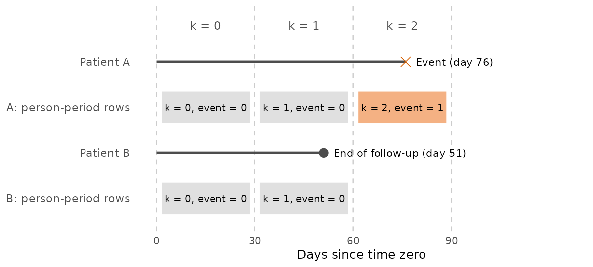
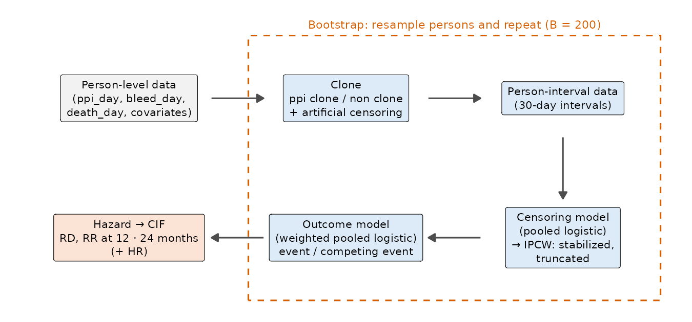
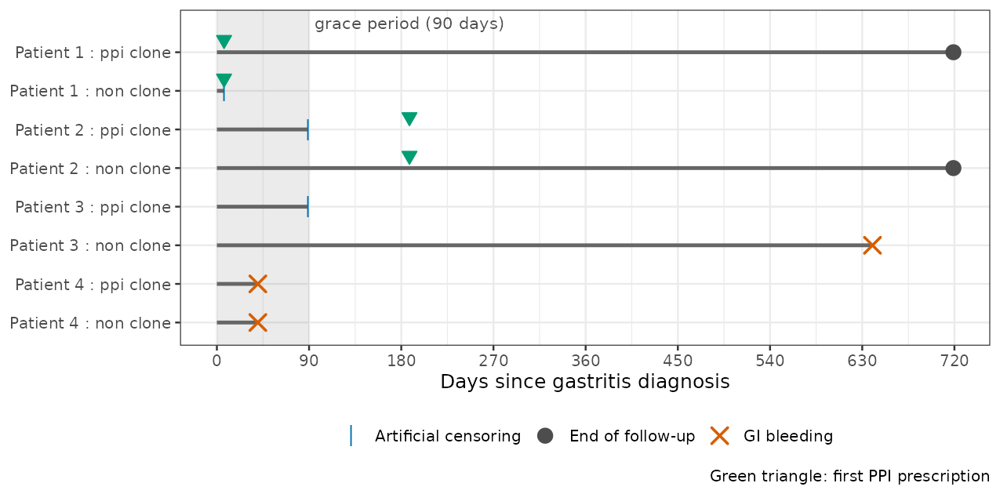

## Introduction

Clone-Censor-Weight(CCW)로 만든 데이터에 weighted Cox model을 적합하면 hazard ratio(HR)가 하나 나옵니다. 그런데 HR 하나로는 **"몇 %가 사건을 겪는가"**에 답하지 못한다는 문제점이 있습니다. 따라서, Cox가 주는 HR은 그대로 주면서 위의 질문에도 답을 해줄 수 있는 pooled logistic regression이 등장합니다. <br>

이 글에서는 CCW 분석의 censoring weight와 결과 모형을 모두 pooled logistic regression으로 적합하고, 그 결과가 Cox model의 HR과 어떻게 이어지는지도 확인해 보겠습니다. CCW의 개념은 [RWD를 이용한 RCT 모방 : Target Trial Emulation by Clone-Censor-Weight method](https://blog.zarathu.com/posts/2024-10-17-tte/)를 참고하시면 됩니다.

## Pooled logistic regression

Pooled logistic regression은 생존 데이터를 한 달씩 쪼개서 이번 달에 출혈이 났는지를 logistic으로 예측합니다. 즉, **"매 구간 사건이 생겼는가(0/1)"**의 반복으로 바꿔 누적하여 "n년 동안 몇 %"를 계산합니다.

### 사람-구간 데이터

우선, 생존 데이터를 일정한 길이(예: 30일)의 구간으로 나누고, 한 사람을 사건이나 censoring이 일어날 때까지 구간마다 한 행으로 펼칩니다. 각 행의 결과변수는 "이 구간에 사건이 일어났는가(0/1)"입니다. 예를 들어, @fig-1 에서 환자 A는 76일째 사건이 생겨 세 번째 구간(`k = 2`)의 `event`가 1이고, 환자 B는 51일째 추적이 끝나 두 행만 남습니다.

{#fig-1 width="700" fig-align="center"}

이렇게 쌓은(pooled) 데이터 전체에 logistic regression을 적합하는 것이 pooled logistic regression입니다.

### 구간별 hazard

적합한 모형의 예측값은 "그 구간까지 사건 없이 온 사람이 그 구간에 사건을 겪을 확률"이고, 이것이 **구간별 hazard**입니다. 구간 번호 `k`를 `factor(k)`나 다항식으로 넣으면 시간에 따라 hazard가 달라지는 모양을 표현할 수 있고, 군 변수를 넣으면 군별 hazard를 얻습니다.

### 누적발생률

구간별 hazard를 알면 누적발생률은 간단히 계산됩니다. 매 구간 "아직 사건이 없을 확률"에 그 구간의 hazard를 곱해서 더해 가면 됩니다.

$$
\text{CIF}(k) = \sum_{j \le k} S(j-1)\, h(j), \qquad S(k) = \prod_{j \le k} \{1 - h(j)\}
$$

경쟁사건이 있으면 $S(k)$를 계산할 때 경쟁사건의 hazard $h_d$에 대해 **사망 hazard $\{1 - h_d(j)\}$**도 같이 곱해 주면 됩니다.

$$
S(k) = \prod_{j \le k} \{1 - h(j)\}\{1 - h_d(j)\}
$$

두 군의 누적발생률을 통해 **RD(차이)**와 **RR(비)**을 구할 수 있습니다. <br>

CCW의 가중치는 사람마다, 달마다 바뀌지만 pooled logistic의 경우, 데이터를 이미 한 달씩 펼쳐 놨으니 각 행에 그 달의 가중치를 붙여서 glm(..., weights = w) 한 줄로 돌리면 됩니다. 가중치를 만드는 모형도 같은 방식으로 만들기 때문에 매우 실용적이라는 장점이 있습니다. <br>

군과 시간의 교호작용을 넣으면 두 군의 hazard가 시간에 따라 다른 모양을 가질 수 있어 **비례위험 가정이 필요 없고**, 경쟁사건의 hazard 모형을 하나 더 적합하면 경쟁위험도 다룰 수 있습니다\[2\].

### Cox model과의 관계

구간이 짧아 구간당 사건 확률이 작으면 odds와 확률이 거의 같아집니다. 그래서 **pooled logistic의 odds ratio는 Cox model의 HR과 거의 같은 값**이 됩니다\[5\].

## 실습

### 분석 흐름

실습은 @fig-3 의 순서로 진행합니다. 사람 단위 데이터를 **clone**해서 사람-구간 데이터로 펼치고, censoring 모형으로 가중치를 만든 뒤, 가중치를 준 결과 모형에서 hazard를 예측해 누적발생률을 계산합니다. 신뢰구간은 이 과정 전체를 bootstrap으로 반복해서 구합니다.

{#fig-3 width="750" fig-align="center"}

### Target trial 설정

이 실습에서는 위염 및 십이지장염(K29) 환자에서 PPI 복용이 상부위장관 출혈을 줄이는지 보는 target trial을 생각해 보겠습니다. 사망은 경쟁사건으로 다룹니다. 이 실습은 pooled logistic을 소개하기 위한 것이므로 임상적 타당성은 고려하지 않았음을 미리 밝힙니다.

| 항목 | 내용 |
|---|---|
| 대상 | 위염 및 십이지장염(K29) 진단 환자 |
| Time zero | 위염 진단일 |
| 전략 1 (ppi) | 진단 후 3개월(90일) 안에 PPI 시작 |
| 전략 2 (non) | 진단 후 3개월 동안 PPI를 복용하지 않음 |
| Outcome | ① 상부위장관 출혈 (사망은 경쟁사건), ② 전체 사망 |
| 추적기간 | 24개월 (30일 구간 24개) |

모든 환자를 두 전략에 하나씩 clone하고, 전략을 벗어나는 시점에 **artificial censoring** 합니다. ppi clone은 90일 안에 PPI를 시작하지 않으면 grace period 마지막 날(89일)에, non clone은 90일 안에 PPI를 시작하면 그날 censoring 됩니다. 같은 날 사건과 censoring이 겹치면 사건을 먼저 봅니다.

{#fig-2 width="750" fig-align="center"}

1번 환자는 grace period 안에서 PPI를 시작했으므로 ppi clone은 끝까지 추적되고 non clone은 7일째 censoring 됩니다. 2, 3번 환자는 90일 안에 시작하지 않았으므로 ppi clone이 89일째 censoring 되고 non clone이 계속 추적됩니다. 2번처럼 grace period가 지난 뒤에 PPI를 시작하는 것은 non 전략을 어긴 것이 아니므로 censoring 하지 않습니다. 4번은 PPI를 시작하기 전에 출혈이 생겨 두 clone 모두 사건으로 끝납니다. <br>

실제 청구자료라면 진료·처방·사망 자료에서 사람마다 time zero, PPI 시작일, 출혈일, 사망일을 뽑아 사람당 한 행으로 만듭니다. 실습에서는 같은 형태의 가상 데이터 3,000명을 만들어 사용합니다.

### 가상 데이터

먼저 필요한 패키지를 불러오고 baseline 공변량을 만듭니다. 나이, 성별, NSAID 복용, 흡연, 동반질환 지수(CCI)입니다.

```{r}
suppressPackageStartupMessages({
  library(data.table); library(magrittr); library(DT)
  library(survival); library(sandwich); library(ggplot2)
})

set.seed(2026)
N <- 3000
dat <- data.table(id      = 1:N,
                  age     = pmin(pmax(round(rnorm(N, 62, 10)), 40), 85),
                  female  = rbinom(N, 1, 0.5),
                  NSAID   = rbinom(N, 1, 0.25),
                  smoking = rbinom(N, 1, 0.35),
                  CCI     = sample(0:2, N, replace = TRUE, prob = c(.5, .3, .2)))
```

첫 PPI 처방일은 젊고, 여성이고, CCI가 낮을수록 빠르게 만들었습니다. 대상자의 60%만 PPI를 복용할 가능성이 있다고 가정하였습니다.

```{r}
rate_ppi <- 0.006 * exp(-0.03 * (dat$age - 62) + 0.6 * dat$female - 0.4 * dat$CCI)
dat[, ppi_day := fifelse(runif(N) < 0.6, floor(rexp(N, rate_ppi)), NA_real_)]
```

출혈은 나이가 많고, NSAID를 복용하고, CCI가 높을수록 잘 생기고, **PPI를 시작한 뒤에는 hazard가 0.7배** 증가한다고 설정하였습니다. PPI 시작과 출혈 위험이 같은 공변량의 영향을 받는 confounding 구조입니다.

```{r}
h_bleed <- 1.5e-4 * exp(0.05 * (dat$age - 62) + 0.5 * dat$NSAID + 0.4 * dat$CCI - 0.3 * dat$female)
E <- rexp(N)
a <- fifelse(is.na(dat$ppi_day), Inf, dat$ppi_day)
dat[, bleed_day := floor(fifelse(E <= h_bleed * a, E / h_bleed, a + (E - h_bleed * a) / (0.7 * h_bleed)))]
```

출혈과 관계없는 사망(PPI 효과 없음)과 추적종료일을 만듭니다. 출혈의 20%는 같은 날 사망으로 이어지고, 10%는 중간에 추적이 끊깁니다.

```{r}
dat[, other_death := floor(rexp(N, 8e-5 * exp(0.07 * (age - 62) + 0.5 * CCI)))]
dat[, fatal := rbinom(N, 1, 0.2)]
dat[, end_day := fifelse(runif(N) < 0.1, floor(runif(N, 0, 720)), 720)]
```

마지막으로 실제로 관찰되는 값만 남깁니다. 사망이나 추적종료 뒤의 출혈, PPI 처방은 지웁니다.

```{r}
dat[, bleed_day := fifelse(bleed_day < pmin(other_death, end_day), bleed_day, NA_real_)]
dat[, death_day := pmin(other_death, fifelse(fatal == 1, bleed_day, NA_real_), na.rm = TRUE)]
dat[death_day >= end_day, death_day := NA]
dat[ppi_day >= pmin(death_day, end_day, na.rm = TRUE), ppi_day := NA]
dat[, c("other_death", "fatal") := NULL]

datatable(dat, rownames = F, caption = "dat ; 가상 데이터", options = list(scrollX = T))
```

참고로 90일 안에 PPI를 시작한 사람과 그렇지 않은 사람을 그냥 비교하면 다음과 같습니다. PPI를 시작한 사람이 원래 젊고 건강한 데다 immortal time까지 섞여 있어, 출혈이 훨씬 적어 보입니다.

```{r}
dat[, .(N = .N, `Bleeding (%)` = round(mean(!is.na(bleed_day)) * 100, 1),
        `Death (%)` = round(mean(!is.na(death_day)) * 100, 1),
        `Mean age` = round(mean(age), 1), `CCI ≥1 (%)` = round(mean(CCI >= 1) * 100, 1)),
    keyby = .(`PPI within 90 days` = !is.na(ppi_day) & ppi_day < 90)] %>%
  datatable(rownames = F, caption = "단순 비교", options = list(dom = "t"))
```

이러한 차이를 걷어내고 같은 사람들이 PPI를 먹었을 때와 안 먹었을 때를 비교하려는 것이 CCW입니다.

## Clone & Censor

### Clone

모든 사람을 ppi clone과 non clone으로 복제하고, clone마다 artificial censoring 날짜(`dev_day`)를 정합니다.

```{r}
GRACE <- 90   # grace period (일)
FU    <- 720  # 추적기간 (일)

clone <- rbind(copy(dat)[, arm := "ppi"], copy(dat)[, arm := "non"])
clone[, start_in_grace := !is.na(ppi_day) & ppi_day < GRACE]
clone[arm == "ppi", dev_day := fifelse(start_in_grace, NA_real_, GRACE - 1)]
clone[arm == "non", dev_day := fifelse(start_in_grace, ppi_day, NA_real_)]
```

### 추적 종료일과 사유

출혈, 사망, censoring, 추적종료 중 가장 먼저 일어난 날을 추적 종료일(`T`)로, 그 사유를 `status`로 둡니다. 같은 날이면 사건 > 경쟁사건 > censoring 순으로 봅니다.

```{r}
clone[, T := pmin(bleed_day, death_day, dev_day, end_day, FU - 1, na.rm = TRUE)]
clone[, status := fcase(!is.na(bleed_day) & bleed_day == T, "event",
                        !is.na(death_day) & death_day == T, "compet",
                        !is.na(dev_day)   & dev_day   == T, "dev",
                        default = "admin")]

datatable(clone[id %in% c(1, 3, 4)][order(id, arm)], rownames = F,
          caption = "clone ; 1, 3, 4번 환자", options = list(scrollX = T))
```

1번 환자는 7일째 PPI를 시작해 non clone이 7일째 censoring(`dev`) 되고, 3번 환자는 188일째 시작해 ppi clone이 89일째 censoring 됩니다. 4번 환자는 PPI 없이 159일째 출혈이 생겨, non clone은 사건이고 ppi clone은 그 전에 89일째 censoring 됩니다.

### 사람-구간 데이터

각 clone을 30일 구간으로 펼칩니다. 마지막 구간에만 `event`(출혈), `compet`(사망), `dev`(censoring) 표시를 합니다. `tstart`, `tstop`은 뒤에서 Cox model과 비교할 때 씁니다.

```{r}
long <- clone[rep(seq_len(.N), floor(T / 30) + 1)]
long[, k := seq_len(.N) - 1L, by = .(id, arm)]
long[, last := k == max(k), by = .(id, arm)]
long[, `:=`(event  = as.integer(last & status == "event"),
            compet = as.integer(last & status == "compet"),
            dev    = as.integer(last & status == "dev"),
            tstart = k * 30,
            tstop  = fifelse(last, T + 1, (k + 1) * 30))]
long[, arm := factor(arm, levels = c("non", "ppi"))]

datatable(long[id == 4, .(id, arm, k, ppi_day, bleed_day, T, status, event, compet, dev)],
          rownames = F, caption = "long ; 4번 환자", options = list(scrollX = T))
```

4번 환자의 ppi clone은 3행(`k` = 0–2)에서 끝나고 마지막 행이 `dev = 1`, non clone은 6행(`k` = 0–5)에서 끝나고 마지막 행이 `event = 1`입니다. 전체 행 수와 사건 수는 다음과 같습니다.

```{r}
long[, .(rows = .N, clones = uniqueN(id), event = sum(event), compet = sum(compet), censored = sum(dev)), by = arm] %>%
  datatable(rownames = F, caption = "long ; arm별 요약", options = list(dom = "t"))
```

## Censoring weight

### Censoring 모형

Artificial censoring은 무작위로 일어나지 않습니다. 젊고 건강한 사람이 PPI를 빨리 시작하므로 non clone에서는 출혈 위험이 낮은 사람이 먼저 빠지고, ppi clone에서는 끝까지 시작하지 않은 나이 많고 동반질환이 많은 사람이 빠집니다. 그래서 **censoring 되지 않고 남을 확률의 역수**를 가중치로 줍니다(IPCW). 이 확률을 사람-구간 데이터에서 logistic regression으로 구합니다. <br>

먼저 구간 끝까지 관찰된 행을 표시합니다. 그 구간에 사건이나 경쟁사건이 생겼거나 추적이 끝난 행은 censoring 여부를 알 수 없으므로 censoring 모형에서 뺍니다.

```{r}
covs <- c("age", "female", "NSAID", "smoking", "CCI")
long[, `:=`(p = 1, q = 1, unc = 1L - dev)]   # unc: 그 구간에 censoring 되지 않음
long[, full := event == 0 & compet == 0 & (dev == 1 | !last | status != "admin")]
```

**non clone**은 grace period의 세 구간(`k` = 0, 1, 2)마다 censoring 될 수 있습니다. 각 구간에서 censoring 되지 않을 확률을 공변량으로 적합한 모형(`p`, denominator)과 시간만 넣은 모형(`q`, numerator)을 만듭니다.

```{r}
G  <- GRACE / 30   # grace period 구간 수 (3)
rs <- long[arm == "non" & k < G & full == TRUE]
fd <- glm(unc ~ factor(k) + age + female + NSAID + smoking + CCI, data = rs, family = binomial)
fn <- glm(unc ~ factor(k), data = rs, family = binomial)
rs[, `:=`(p = fitted(fd), q = fitted(fn))]
long[rs, on = .(id, arm, k), `:=`(p = i.p, q = i.q)]
```

**ppi clone**은 마지막 grace 구간(`k` = 2)까지 PPI를 시작하지 않은 사람만 censoring 될 수 있습니다. denominator는 이 사람들(`rs`)에서 적합하고, 이미 시작한 사람은 1로 둡니다. numerator는 그 구간에 남아 있는 ppi clone 전체(`rs_all`)에서 적합합니다.

```{r}
rs_all <- long[arm == "ppi" & k == G - 1 & full == TRUE]
rs     <- rs_all[is.na(ppi_day) | ppi_day >= (G - 1) * 30]   # 아직 시작하지 않은 사람
fd <- glm(unc ~ age + female + NSAID + smoking + CCI, data = rs, family = binomial)
fn <- glm(unc ~ 1, data = rs_all, family = binomial)
rs[, p := fitted(fd)]
rs_all[, q := fitted(fn)]
long[rs, on = .(id, arm, k), p := i.p]
long[rs_all, on = .(id, arm, k), q := i.q]
```

numerator를 denominator처럼 "아직 시작하지 않은 사람"에서만 적합하면 numerator가 각자의 치료 이력에 따라 달라져 결과가 틀어집니다. numerator에는 결과 모형에 들어가는 변수(군과 시간)만 들어가야 합니다\[6\]. <br>

이제 확률을 사람별로 누적해서 곱하고 역수를 취합니다. 구간 $k$ 끝의 확률은 다음 구간부터 반영합니다. `w_unstab`은 1/p의 누적곱, `w_stab`은 q/p의 누적곱입니다.

```{r}
setorder(long, arm, id, k)
long[, `:=`(w_unstab = 1 / cumprod(shift(p, fill = 1)),
            w_stab   = cumprod(shift(q, fill = 1)) / cumprod(shift(p, fill = 1))), by = .(arm, id)]
```

마지막으로 너무 큰 가중치를 자릅니다(truncation). 군별로 clone마다 마지막 행의 가중치를 모아 99번째 백분위수를 구하고, 그 값을 넘는 가중치를 그 값으로 바꿉니다.

```{r}
thr <- long[, .(w = w_stab[.N]), by = .(arm, id)][, .(thr = quantile(w, 0.99)), by = arm]
long[thr, on = "arm", w_trunc := pmin(w_stab, i.thr)]

datatable(long[id %in% c(1, 4) & k <= 4, .(id, arm, k, ppi_day, p, q, w_unstab, w_stab, w_trunc)] %>%
            .[, lapply(.SD, function(x) if (is.double(x)) round(x, 3) else x)],
          rownames = F, caption = "long ; 가중치", options = list(scrollX = T))
```

1번 환자의 ppi clone은 첫 구간에 PPI를 시작해 censoring 될 일이 없으므로 `p`가 1입니다. 다만 `q`는 그 구간에 남아 있는 ppi clone 전체에서 구한 값이라 1보다 작고, 그래서 `k = 3`부터 `w_stab`이 1보다 작아집니다. 4번 환자의 non clone은 `k` = 0–2에서 `p`, `q`가 계산되고, 그 곱이 다음 구간부터 가중치로 쌓입니다.

### 가중치 옵션

가중치를 만들 때 정해야 하는 것은 크게 네 가지입니다.

| 옵션 | 선택지 | 이 글의 선택 |
|---|---|---|
| Censoring 모형 | Cox, pooled logistic | pooled logistic |
| 공변량 | baseline 공변량, 시간에 따라 변하는 공변량 추가 | baseline 공변량 5개 |
| 안정화 | unstabilized, stabilized | stabilized |
| 절단(truncation) | 없음, 99.9%, 99.5%, 99% 등 | 군별 99% |

실제 데이터에서는 직전 달 입원 여부나 외래 방문 횟수처럼 시간에 따라 변하면서 치료 시작에도 영향을 주는 변수가 있습니다. 이런 변수는 사람-구간 데이터의 각 행에 그 시점 값을 붙여 censoring 모형에 넣으면 됩니다. Stabilized weight는 평균이 1 근처로 유지되고 분산이 작습니다. 절단은 분산을 줄이지만 그만큼 보정이 덜 되므로 편향이 생길 수 있습니다\[6\].

### 가중치 분포

grace period 직후 구간(`k = 3`)까지 남아 있는 clone의 가중치를 비교합니다. ESS(effective sample size)는 가중치가 고르지 않을수록 작아지는 유효표본수입니다.

```{r}
w_k3 <- melt(long[k == 3, .(arm, id, w_unstab, w_stab, w_trunc)], id.vars = c("arm", "id"), variable.name = "weight")
w_k3[, .(n = .N, mean = mean(value), sd = sd(value), min = min(value), median = median(value),
         max = max(value), ESS = sum(value)^2 / sum(value^2)), keyby = .(weight, arm)] %>%
  .[, lapply(.SD, function(x) if (is.double(x)) round(x, 2) else x)] %>%
  datatable(rownames = F, caption = "k = 3 가중치 분포", options = list(dom = "t", scrollX = T))
```

```{r}
#| label: fig-4
#| fig-cap: "Grace period 직후(k = 3) 남아 있는 clone의 가중치 분포"
#| fig-width: 8
#| fig-height: 4
w_k3[, weight := factor(weight, levels = c("w_unstab", "w_stab", "w_trunc"),
                        labels = c("Unstabilized", "Stabilized", "Stabilized + 99% truncation"))]
ggplot(w_k3, aes(value, fill = arm)) +
  geom_histogram(bins = 40, colour = "white", linewidth = 0.1) +
  geom_vline(xintercept = 1, linetype = "dashed", colour = "grey40") +
  facet_grid(arm ~ weight, scales = "free_y") +
  scale_x_log10() +
  scale_fill_manual(values = c(non = "#56B4E9", ppi = "#E69F00"), guide = "none") +
  labs(x = "Weight (log scale)", y = "Clones") +
  theme_bw()
```

non clone의 가중치는 1 근처에 모여 있습니다. ppi clone은 두 덩어리로 나뉩니다. 처음 두 구간 안에 PPI를 시작한 사람은 censoring 될 일이 없어 denominator가 1이고, 마지막 구간에 시작한 사람은 그 구간에 censoring 된 사람들의 몫까지 대신하므로 큰 가중치를 받습니다. Unstabilized에서는 뒤쪽 덩어리가 30을 넘기도 합니다. Stabilized에서는 같은 numerator가 곱해져 전체가 왼쪽으로 옮겨 가고, 99%에서 자르면 오른쪽 꼬리가 잘리면서 ESS가 조금 커집니다.

### 공변량 균형

가중치가 제 역할을 하는지는 같은 시점(`k = 3`)에 남아 있는 두 군의 standardized mean difference(SMD)로 확인합니다.

```{r}
#| label: fig-5
#| fig-cap: "Grace period 직후 두 군 clone의 공변량 균형"
#| fig-width: 6
#| fig-height: 3
smd <- function(x, g, w) {
  m1 <- weighted.mean(x[g], w[g]); m0 <- weighted.mean(x[!g], w[!g])
  v1 <- sum(w[g] * (x[g] - m1)^2) / sum(w[g]); v0 <- sum(w[!g] * (x[!g] - m0)^2) / sum(w[!g])
  (m1 - m0) / sqrt((v1 + v0) / 2)
}
b3 <- long[k == 3]
bal <- rbind(data.table(Weight = "No weight", variable = covs,
                        SMD = sapply(covs, function(v) smd(b3[[v]], b3$arm == "ppi", rep(1, nrow(b3))))),
             data.table(Weight = "Stabilized + 99% truncation", variable = covs,
                        SMD = sapply(covs, function(v) smd(b3[[v]], b3$arm == "ppi", b3$w_trunc))))
ggplot(bal, aes(x = abs(SMD), y = variable, color = Weight)) +
  geom_point(size = 3) +
  geom_vline(xintercept = 0.1, linetype = "dashed", color = "grey50") +
  scale_color_manual(values = c("grey50", "#D55E00")) +
  labs(x = "Absolute SMD (ppi vs non clones)", y = NULL, color = NULL) +
  theme_bw() + theme(legend.position = "bottom")
```

가중치를 주기 전에는 나이, 성별, CCI의 SMD가 0.1을 넘지만, 가중치를 주면 모두 0.1 아래로 들어옵니다.

## Outcome 모형

### Hazard 모형

가중치를 준 상태에서 출혈을 결과로 하는 pooled logistic을 적합합니다. `arm * (k + I(k^2))`로 군과 시간의 교호작용을 넣어 두 군의 hazard 모양이 달라질 수 있게 했습니다. 가중치가 정수가 아니어서 `quasibinomial`을 썼고, 점추정값은 `binomial`과 같습니다.

```{r}
fe <- glm(event ~ arm * (k + I(k^2)), data = long, weights = w_trunc, family = quasibinomial)
```

경쟁사건(사망) hazard 모형도 같은 형태로 적합합니다. 같은 구간에 출혈이 있으면 출혈을 먼저 보므로, 출혈이 없는 행에서 적합합니다.

```{r}
fc <- glm(compet ~ arm * (k + I(k^2)), data = long[event == 0], weights = w_trunc, family = quasibinomial)
```

### 누적발생률

두 군의 구간별 hazard를 예측하고, 누적해서 누적발생률(`cif`)을 계산합니다.

```{r}
nd <- CJ(arm = factor(c("non", "ppi"), levels = c("non", "ppi")), k = 0:23)
nd[, he := predict(fe, nd, type = "response")]   # 출혈 hazard
nd[, hc := predict(fc, nd, type = "response")]   # 사망 hazard
nd[, S := cumprod((1 - he) * (1 - hc)), by = arm]
nd[, cif := cumsum(shift(S, fill = 1) * he), by = arm]

datatable(nd[, lapply(.SD, function(x) if (is.double(x)) round(x, 4) else x)],
          rownames = F, caption = "nd ; 구간별 hazard와 누적발생률", options = list(scrollX = T))
```

12개월(`k = 11`)과 24개월(`k = 23`) 시점의 RD, RR을 구합니다.

```{r}
dcast(nd[k %in% c(11, 23)], k ~ arm, value.var = "cif")[, `:=`(RD = ppi - non, RR = ppi / non)] %>%
  .[, lapply(.SD, function(x) if (is.double(x)) round(x, 4) else x)] %>%
  datatable(rownames = F, caption = "12, 24개월 RD와 RR", options = list(dom = "t"))
```

### 가중치 옵션별 결과

가중치만 바꿔서 24개월 출혈 위험을 비교해 보겠습니다. 위의 hazard 모형과 누적발생률 계산을 함수로 묶어 둡니다.

```{r}
cif_fun <- function(lg, w = "w_trunc") {
  lg <- copy(lg)[, ww := get(w)]
  fe <- glm(event ~ arm * (k + I(k^2)), data = lg, weights = ww, family = quasibinomial)
  fc <- if (any(lg$compet == 1)) glm(compet ~ arm * (k + I(k^2)), data = lg[event == 0], weights = ww, family = quasibinomial)
  nd <- CJ(arm = factor(c("non", "ppi"), levels = c("non", "ppi")), k = 0:max(lg$k))
  nd[, he := predict(fe, nd, type = "response")]
  nd[, hc := if (is.null(fc)) 0 else predict(fc, nd, type = "response")]
  nd[, S := cumprod((1 - he) * (1 - hc)), by = arm]
  nd[, cif := cumsum(shift(S, fill = 1) * he), by = arm]
  nd[]
}
```

가중치 없음, unstabilized, stabilized, 99.5% 절단, 99% 절단을 비교합니다.

```{r}
long[, w_none := 1]
thr995 <- long[, .(w = w_stab[.N]), by = .(arm, id)][, .(thr = quantile(w, .995)), by = arm]
long[thr995, on = "arm", w_trunc995 := pmin(w_stab, i.thr)]

w_opts <- c(w_none = "No weight", w_unstab = "Unstabilized", w_stab = "Stabilized",
            w_trunc995 = "Stabilized + 99.5% truncation", w_trunc = "Stabilized + 99% truncation")
lapply(names(w_opts), function(w) {
  cf <- cif_fun(long, w)[k == 23]
  data.table(Weight = w_opts[[w]], Risk_non = cf[arm == "non", cif], Risk_ppi = cf[arm == "ppi", cif])
}) %>% rbindlist() %>% .[, `:=`(RD = Risk_ppi - Risk_non, RR = Risk_ppi / Risk_non)] %>%
  .[, lapply(.SD, function(x) if (is.double(x)) round(x, 4) else x)] %>%
  datatable(rownames = F, caption = "가중치 옵션별 24개월 출혈 위험", options = list(dom = "t"))
```

가중치 없이 분석하면 RR이 0.72로 PPI 효과가 부풀려집니다. non clone에서는 젊고 건강한 사람이 빠져 위험이 높게, ppi clone에서는 나이 많고 동반질환이 많은 사람이 빠져 위험이 낮게 추정되기 때문입니다. 가중치를 주면 RR이 0.86(unstabilized), 0.88(stabilized)로 올라가고, 두 값은 거의 같습니다. 절단 기준을 99.5%, 99%로 낮추면 RR이 0.85, 0.83으로 조금씩 내려갑니다. 큰 가중치를 받던 사람들의 몫이 줄어들기 때문입니다. 이렇게 절단 기준에 따라 결과가 움직이므로, 어떤 기준을 쓸지 미리 정해 두고 다른 기준의 결과는 민감도 분석으로 함께 보고하는 게 좋습니다.

## Bootstrap 신뢰구간

같은 사람이 두 군에 모두 들어가 있고 가중치도 추정한 값이므로 모형이 주는 표준오차를 그대로 쓸 수 없습니다. 사람 단위로 재표본추출한 뒤 clone부터 결과 모형까지 매번 다시 적합하는 bootstrap을 씁니다. 이를 위해 앞에서 한 과정을 함수로 묶겠습니다. <br>

`make_long()`은 clone, 추적 종료일, 사람-구간 펼치기를 한 번에 합니다. `oc`로 outcome(출혈 또는 사망)을, `bin`으로 구간 길이를 정합니다.

```{r}
make_long <- function(dat, oc, bin = 30) {
  cl <- rbind(copy(dat)[, arm := "ppi"], copy(dat)[, arm := "non"])
  cl[, start_in_grace := !is.na(ppi_day) & ppi_day < GRACE]
  cl[arm == "ppi", dev_day := fifelse(start_in_grace, NA_real_, GRACE - 1)]
  cl[arm == "non", dev_day := fifelse(start_in_grace, ppi_day, NA_real_)]
  cl[, oc_day := get(paste0(oc, "_day"))]
  cl[, cmp_day := if (oc == "death") NA_real_ else death_day]
  cl[, T := pmin(oc_day, cmp_day, dev_day, end_day, FU - 1, na.rm = TRUE)]
  cl[, status := fcase(!is.na(oc_day) & oc_day == T, "event", !is.na(cmp_day) & cmp_day == T, "compet",
                       !is.na(dev_day) & dev_day == T, "dev", default = "admin")]
  lg <- cl[rep(seq_len(.N), floor(T / bin) + 1)]
  lg[, k := seq_len(.N) - 1L, by = .(id, arm)]
  lg[, last := k == max(k), by = .(id, arm)]
  lg[, `:=`(event = as.integer(last & status == "event"), compet = as.integer(last & status == "compet"),
            dev = as.integer(last & status == "dev"), tstart = k * bin, tstop = fifelse(last, T + 1, (k + 1) * bin))]
  lg[, arm := factor(arm, levels = c("non", "ppi"))]
  lg[]
}
```

`add_ipcw()`는 censoring 모형, 누적 가중치, 절단을 한 번에 합니다. grace period의 구간 수(`G`)는 구간 길이에 따라 정해집니다.

```{r}
add_ipcw <- function(lg, bin = 30, trunc = 0.99) {
  G  <- GRACE / bin
  tk <- if (G > 1) "factor(k) + " else ""
  lg[, `:=`(p = 1, q = 1, unc = 1L - dev)]
  lg[, full := event == 0 & compet == 0 & (dev == 1 | !last | status != "admin")]
  rs <- lg[arm == "non" & k < G & full == TRUE]
  fd <- glm(as.formula(paste("unc ~", tk, paste(covs, collapse = " + "))), data = rs, family = binomial)
  fn <- glm(as.formula(paste("unc ~", if (G > 1) "factor(k)" else "1")), data = rs, family = binomial)
  rs[, `:=`(p = fitted(fd), q = fitted(fn))]
  lg[rs, on = .(id, arm, k), `:=`(p = i.p, q = i.q)]
  rs_all <- lg[arm == "ppi" & k == G - 1 & full == TRUE]
  rs     <- rs_all[is.na(ppi_day) | ppi_day >= (G - 1) * bin]
  fd <- glm(as.formula(paste("unc ~", paste(covs, collapse = " + "))), data = rs, family = binomial)
  fn <- glm(unc ~ 1, data = rs_all, family = binomial)
  rs[, p := fitted(fd)]; rs_all[, q := fitted(fn)]
  lg[rs, on = .(id, arm, k), p := i.p]
  lg[rs_all, on = .(id, arm, k), q := i.q]
  setorder(lg, arm, id, k)
  lg[, `:=`(w_unstab = 1 / cumprod(shift(p, fill = 1)),
            w_stab   = cumprod(shift(q, fill = 1)) / cumprod(shift(p, fill = 1))), by = .(arm, id)]
  thr <- lg[, .(w = w_stab[.N]), by = .(arm, id)][, .(thr = quantile(w, trunc)), by = arm]
  lg[thr, on = "arm", w_trunc := pmin(w_stab, i.thr)]
  lg[]
}
```

출혈과 전체 사망 각각에 대해 bootstrap을 200회 돌립니다. 실제 연구에서는 500회 이상 돌리는 게 좋고, 시간이 오래 걸리면 `parallel::mclapply()`로 병렬 처리하면 됩니다.

```{r}
run_ccw <- function(d, oc) make_long(d, oc) %>% add_ipcw() %>% cif_fun()

B <- 200
boot_res <- lapply(c("bleed", "death"), function(oc) {
  lapply(1:B, function(b) {
    set.seed(b)
    db <- dat[sample(.N, replace = TRUE)][, id := .I]   # 사람 단위 재표본
    run_ccw(db, oc)[, `:=`(b = b, outcome = oc)]
  }) %>% rbindlist()
}) %>% rbindlist()

point <- lapply(c("bleed", "death"), function(oc) run_ccw(dat, oc)[, outcome := oc]) %>% rbindlist()
```

점추정값은 원래 데이터로, 95% 신뢰구간은 bootstrap 분포의 2.5, 97.5 백분위수로 구합니다.

```{r}
oc_lab  <- c(bleed = "Upper GI bleeding", death = "All-cause death")
rd_est  <- dcast(point, outcome + k ~ arm, value.var = "cif")[, `:=`(RD = ppi - non, RR = ppi / non)]
rd_boot <- dcast(boot_res, outcome + k + b ~ arm, value.var = "cif")[, `:=`(RD = ppi - non, RR = ppi / non)]
ci  <- rd_boot[, .(RD_lo = quantile(RD, .025), RD_hi = quantile(RD, .975),
                   RR_lo = quantile(RR, .025), RR_hi = quantile(RR, .975)), by = .(outcome, k)]
res <- merge(rd_est, ci, by = c("outcome", "k"))

res[k %in% c(11, 23)][order(match(outcome, names(oc_lab)), k),
    .(Outcome = oc_lab[outcome], Month = k + 1,
      `Risk, non (%)` = sprintf("%.1f", non * 100),
      `Risk, ppi (%)` = sprintf("%.1f", ppi * 100),
      `RD, %p (95% CI)` = sprintf("%.1f (%.1f, %.1f)", RD * 100, RD_lo * 100, RD_hi * 100),
      `RR (95% CI)` = sprintf("%.2f (%.2f, %.2f)", RR, RR_lo, RR_hi))] %>%
  datatable(rownames = F, caption = "12, 24개월 위험, RD, RR", options = list(dom = "t", scrollX = T))
```

24개월 출혈 위험은 3개월 안에 PPI를 시작하는 전략에서 10.7%, 시작하지 않는 전략에서 12.8%로, RD는 −2.1%p(95% CI −6.0, 2.0), RR은 0.83(95% CI 0.55, 1.16)입니다. 점추정값만 보면 24개월 동안 100명당 출혈이 약 2건 적게 생긴다는 뜻이고, RCT 결과를 읽는 것과 같은 방식으로 해석할 수 있습니다. 다만 ppi clone의 가중치가 고르지 않아 ESS가 작고, 그래서 신뢰구간이 넓어 0(RR은 1)을 포함합니다. 가상 데이터에서 PPI는 치명적 출혈을 통해서만 사망에 영향을 주도록 만들었기 때문에, 24개월 전체 사망은 두 전략이 거의 같습니다(RR 1.01). <br>

처음에 단순 비교했을 때는 출혈이 8.6% 대 13.1%(RR 약 0.66)로 PPI 효과가 훨씬 커 보였습니다. Clone-censor-weight로 confounding과 immortal time을 보정하면 효과가 이만큼 줄어듭니다.

### 누적발생률 곡선

```{r}
#| label: fig-6
#| fig-cap: "전략별 누적발생률 곡선 (음영은 bootstrap 95% CI)"
#| fig-width: 9
#| fig-height: 4
arm_lab <- c(ppi = "PPI within 3 months", non = "No PPI within 3 months")
band <- boot_res[, .(lo = quantile(cif, .025), hi = quantile(cif, .975)), by = .(outcome, arm, k)]
pc <- merge(point, band, by = c("outcome", "arm", "k"))
pc <- rbind(pc[k == 0][, `:=`(k = -1L, cif = 0, lo = 0, hi = 0)], pc, fill = TRUE)
pc[, `:=`(day = (k + 1) * 30, Outcome = factor(oc_lab[outcome], levels = oc_lab), Strategy = arm_lab[as.character(arm)])]
ggplot(pc, aes(day, cif * 100, color = Strategy, fill = Strategy)) +
  geom_ribbon(aes(ymin = lo * 100, ymax = hi * 100), alpha = 0.15, color = NA) +
  geom_line(linewidth = 0.9) +
  geom_vline(xintercept = GRACE, linetype = "dashed", color = "grey50") +
  facet_wrap(~Outcome) +
  scale_x_continuous(breaks = seq(0, 720, 90)) +
  scale_color_manual(values = c("#0072B2", "#D55E00"), aesthetics = c("color", "fill")) +
  labs(x = "Days since gastritis diagnosis", y = "Cumulative incidence (%)", color = NULL, fill = NULL) +
  theme_bw() + theme(legend.position = "bottom")
```

```{r}
#| echo: false
ggsave("img/cif.png", last_plot(), width = 9, height = 4, dpi = 150)
```

점선은 grace period가 끝나는 90일입니다. Grace period 동안은 ppi 군에서도 아직 PPI를 시작하지 않은 사람이 많아 두 곡선이 거의 겹치고, 출혈 곡선은 1년이 지나면서 조금씩 벌어집니다.

### 시점별 risk difference

```{r}
#| label: fig-7
#| fig-cap: "시점별 risk difference (ppi − non)와 bootstrap 95% CI"
#| fig-width: 9
#| fig-height: 3.5
prd <- copy(res)[, `:=`(day = (k + 1) * 30, Outcome = factor(oc_lab[outcome], levels = oc_lab))]
ggplot(prd, aes(day, RD * 100)) +
  geom_ribbon(aes(ymin = RD_lo * 100, ymax = RD_hi * 100), alpha = 0.2) +
  geom_line(linewidth = 0.9) +
  geom_hline(yintercept = 0, linetype = "dashed") +
  facet_wrap(~Outcome) +
  scale_x_continuous(breaks = seq(0, 720, 90)) +
  labs(x = "Days since gastritis diagnosis", y = "Risk difference (%p)") +
  theme_bw()
```

## Cox model과 비교

### Hazard ratio

결과 모형에서 교호작용을 빼고 `arm` 주효과만 넣으면, 그 계수의 지수값(odds ratio)을 HR처럼 볼 수 있습니다. 같은 가중치로 weighted Cox model도 적합해서 비교합니다. 신뢰구간은 같은 사람의 clone과 반복 행을 고려한 robust 표준오차로 구했습니다.

```{r}
hr_tab <- lapply(c("bleed", "death"), function(oc) {
  lg <- make_long(dat, oc) %>% add_ipcw()
  fp <- glm(event ~ arm + k + I(k^2), data = lg, weights = w_trunc, family = quasibinomial)
  se <- sqrt(vcovCL(fp, cluster = ~id)["armppi", "armppi"])
  fc <- coxph(Surv(tstart, tstop, event) ~ arm, data = lg, weights = w_trunc, cluster = id)
  ci_c <- summary(fc)$conf.int
  data.table(Outcome = oc_lab[[oc]],
             `Pooled logistic OR (95% CI)` = sprintf("%.3f (%.3f, %.3f)", exp(coef(fp)["armppi"]),
                                                     exp(coef(fp)["armppi"] - 1.96 * se), exp(coef(fp)["armppi"] + 1.96 * se)),
             `Weighted Cox HR (95% CI)` = sprintf("%.3f (%.3f, %.3f)", ci_c[1, 1], ci_c[1, 3], ci_c[1, 4]))
}) %>% rbindlist()
datatable(hr_tab, rownames = F, caption = "Pooled logistic OR vs Cox HR", options = list(dom = "t"))
```

두 값이 거의 같습니다. 출혈 분석의 Cox model은 사망을 censoring으로 처리했으므로 cause-specific HR이고, pooled logistic의 사건 모형도 같은 대상을 추정합니다.

### 구간 길이

구간 길이를 90일, 30일, 10일로 바꿔 같은 분석을 반복합니다. 시간은 `factor(k)`로 넣어 구간마다 따로 추정했습니다.

```{r}
lapply(c(90, 30, 10), function(b) {
  lg <- make_long(dat, "bleed", bin = b) %>% add_ipcw(bin = b)
  fp <- glm(event ~ arm + factor(k), data = lg, weights = w_trunc, family = quasibinomial)
  fc <- coxph(Surv(tstart, tstop, event) ~ arm, data = lg, weights = w_trunc)
  data.table(`Interval (days)` = b, Rows = nrow(lg),
             `Mean interval hazard` = round(weighted.mean(lg$event, lg$w_trunc), 4),
             `Pooled logistic OR` = round(exp(coef(fp)[["armppi"]]), 3),
             `Weighted Cox HR` = round(exp(coef(fc)[["armppi"]]), 3))
}) %>% rbindlist() %>%
  datatable(rownames = F, caption = "구간 길이별 OR과 HR", options = list(dom = "t"))
```

구간이 90일이면 OR 0.955, HR 0.905로 차이가 꽤 나지만, 30일에서는 0.861과 0.846, 10일에서는 0.822와 0.817로 가까워집니다. 구간이 길면 구간 안에서 언제 사건이나 censoring이 일어났는지에 대한 정보가 사라지고, 구간당 사건 확률도 커지기 때문입니다. 구간 길이가 바뀌면 grace period 안의 가중치 모형도 달라지므로 Cox HR도 조금씩 달라집니다. 구간을 짧게 할수록 행 수가 늘어나니, 사건 빈도와 계산량을 보고 정하면 됩니다. 월 단위(30일) 구간이 무난한 선택입니다.

## Conclusion

처음 질문으로 돌아가 보면, HR 하나 대신 3개월 안에 PPI를 시작하는 전략과 시작하지 않는 전략에서 2년 동안 출혈이 각각 몇 % 생기는지(10.7%, 12.8%)와 그 차이를 구했습니다. Pooled logistic regression은 생존 데이터를 사람-구간 데이터로 펼쳐 구간별 hazard를 추정하므로 이런 답을 바로 줍니다. CCW 분석에서는 가중치 모형과 결과 모형을 같은 데이터에서 같은 방법으로 적합할 수 있고, 구간별 hazard로부터 누적발생률, RD, RR을 바로 계산할 수 있습니다. 군과 시간의 교호작용을 넣으면 비례위험 가정 없이 분석할 수 있고, 경쟁사건도 hazard 모형을 하나 더 적합해서 다룰 수 있습니다. <br>

구간이 짧고 사건이 드물면 군 주효과의 odds ratio는 Cox HR과 거의 같습니다. 결국 pooled logistic은 Cox model을 대신하는 새로운 방법이라기보다, Cox가 주는 HR은 그대로 얻으면서 RCT처럼 절대위험의 차이까지 보여줄 수 있는 방법이라고 보면 됩니다. 가중치를 만들 때는 stabilized weight의 numerator를 어떤 사람들로 적합하는지, 절단 기준에 따라 결과가 얼마나 움직이는지를 꼭 확인하시길 바랍니다.

## Reference

\[1\] Hernán MA. The hazards of hazard ratios. *Epidemiology*. 2010;21(1):13-15.

\[2\] Young JG, Stensrud MJ, Tchetgen Tchetgen EJ, Hernán MA. A causal framework for classical statistical estimands in failure-time settings with competing events. *Stat Med*. 2020;39(8):1199-1236.

\[3\] Hernán MA, Alonso A, Logan R, et al. Observational studies analyzed like randomized experiments: an application to postmenopausal hormone therapy and coronary heart disease. *Epidemiology*. 2008;19(6):766-779.

\[4\] Hernán MA, Robins JM. *Causal Inference: What If*. Boca Raton: Chapman & Hall/CRC; 2020.

\[5\] D'Agostino RB, Lee ML, Belanger AJ, Cupples LA, Anderson K, Kannel WB. Relation of pooled logistic regression to time dependent Cox regression analysis: the Framingham Heart Study. *Stat Med*. 1990;9(12):1501-1515.

\[6\] Cole SR, Hernán MA. Constructing inverse probability weights for marginal structural models. *Am J Epidemiol*. 2008;168(6):656-664.
